<!-- ───────────────────────────── HEADER ───────────────────────────── -->

  

  

  
  
  
  
  

  
  
  

 

## 👨‍💻 About me

I'm a **full-stack developer** who builds **production-ready web apps and AI products**. I started in the MERN stack and grew into **generative AI**: voice agents, RAG, embeddings, transcription and automation. I like owning the whole arc, from product thinking to UI, architecture, testing and deployment, then improving it through real-world use.

- 🏥 **Now:** Full-stack & Applied AI Engineer at **[Goose Labs](https://gooselabs.in)**, building AI-first healthcare SaaS end to end
- 🌿 **Before:** Forward Deployed Engineer at **[Prānaa](https://pranaa.in)**, building a longevity clinic's patient journey and digital intake
- 🧠 **Focus:** LLMs · voice agents · RAG · clinical workflow automation
- 🎓 **Education:** B.Tech Computer Science, CSVTU (2022–2025)
- 🤝 **Open to:** collaborating on AI products, healthtech and ambitious side projects

 

## 🚀 Featured work

<table>
  <tr>
    <td width="50%" valign="top">
      <a href="https://mediscribe.gooselabs.in/">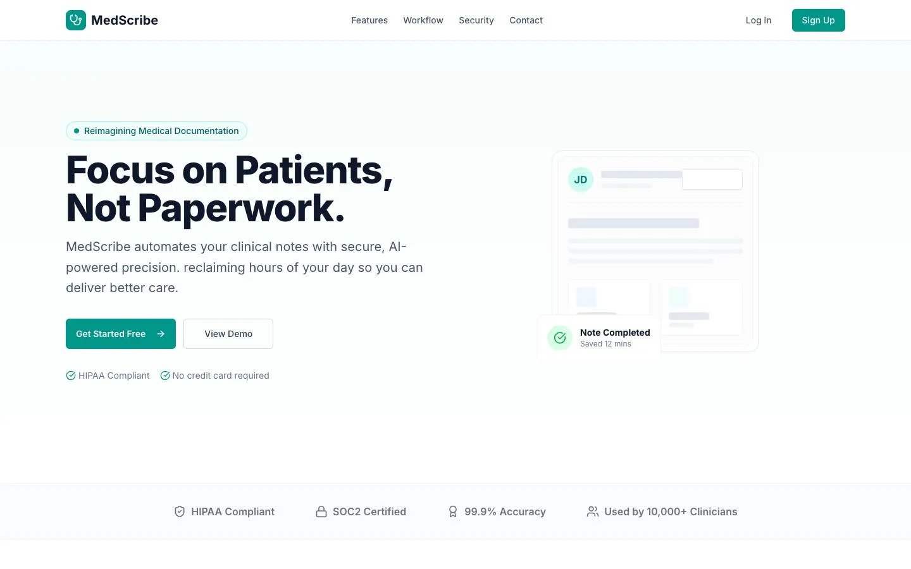</a>
      <h3><a href="https://mediscribe.gooselabs.in/">MedScribe</a></h3>
      <b>AI CLINICAL DOCUMENTATION · GOOSE LABS</b>
      
Turns doctor–patient conversations into structured medical documentation, from conversation to chart in seconds.

    </td>
    <td width="50%" valign="top">
      <a href="https://engage.gooselabs.in/">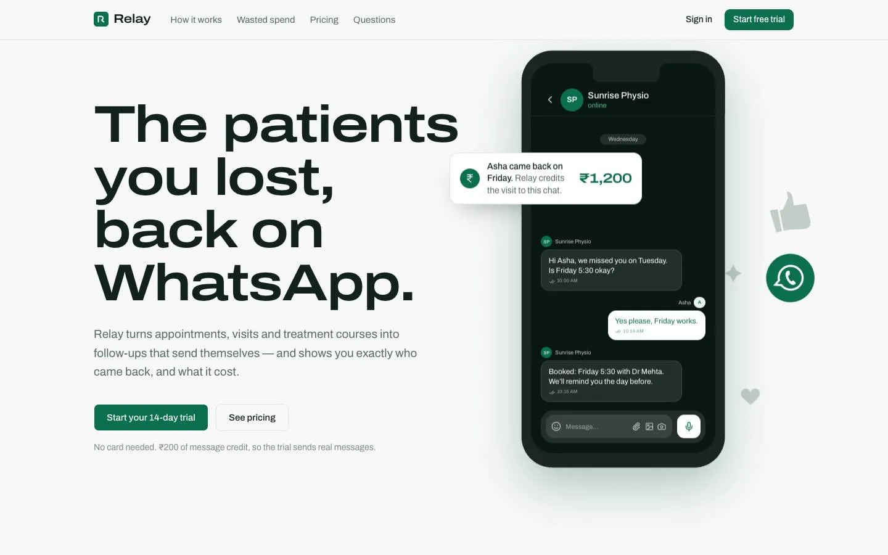</a>
      <h3><a href="https://engage.gooselabs.in/">Engage</a></h3>
      <b>WHATSAPP PATIENT-ENGAGEMENT SAAS · GOOSE LABS</b>
      
Brings missed and lapsed patients back into care over WhatsApp with reminders, no-show recovery, attribution and spend analytics.

    </td>
  </tr>
  <tr>
    <td width="50%" valign="top">
      <a href="https://yi-hum-5-voice-agent.vercel.app/">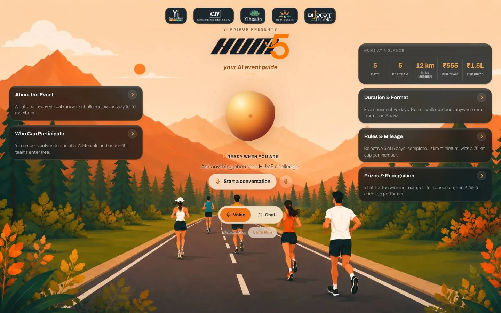</a>
      <h3><a href="https://yi-hum-5-voice-agent.vercel.app/">Hum Paanch</a></h3>
      <b>AI VOICE AGENT · NEXT.JS + ELEVENLABS</b>
      
A voice-first event guide. Visitors talk to it out loud or switch to a text transcript, and both modes drive the same agent.

    </td>
    <td width="50%" valign="top">
      <a href="https://pranaa.in/">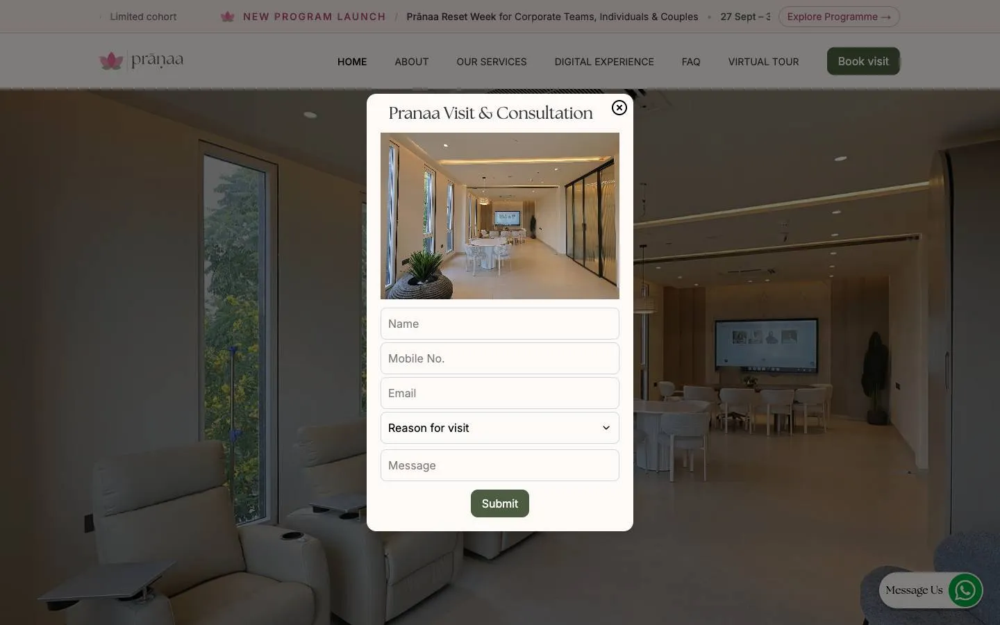</a>
      <h3><a href="https://pranaa.in/">Prānaa</a></h3>
      <b>WELLNESS & LONGEVITY PLATFORM</b>
      
The digital front door for a regenerative-medicine clinic, covering services, patient journey, digital intake, diagnostics and outcome tracking.

    </td>
  </tr>
  <tr>
    <td width="50%" valign="top">
      <a href="https://datesite-sfbp.vercel.app/">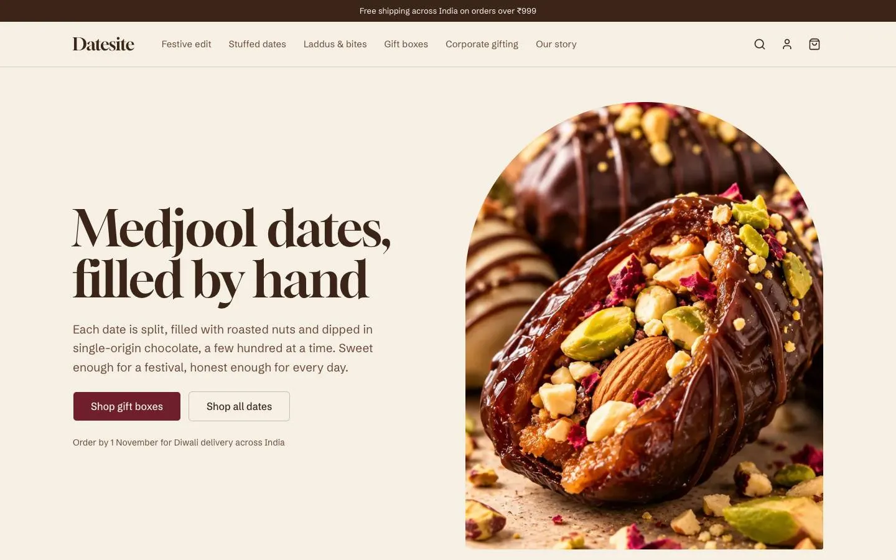</a>
      <h3><a href="https://datesite-sfbp.vercel.app/">Datesite</a></h3>
      <b>PREMIUM E-COMMERCE</b>
      
A storytelling-led shop for handmade dates, laddus and gift boxes, with collections, a gift-box builder, cart and checkout.

    </td>
    <td width="50%" valign="middle" align="center">
      <h3>More on my portfolio →</h3>
      
Case studies, experiments and everything I'm building right now.

      
    </td>
  </tr>
</table>

 

## 🛠️ Tech stack

   
   
  

  
  
  
  
  
  
  
  
  

 

## 📊 GitHub stats

  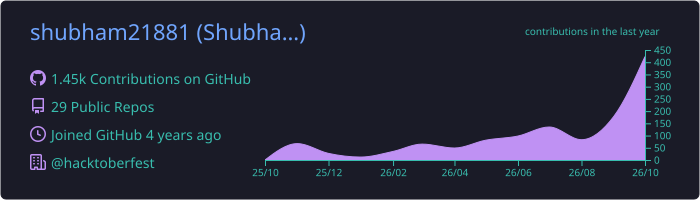

  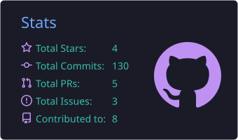
  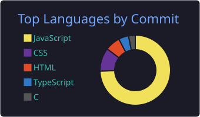

  

  <picture>
    <source media="(prefers-color-scheme: dark)" srcset="https://raw.githubusercontent.com/shubham21881/shubham21881/output/snake-dark.svg" />
    <source media="(prefers-color-scheme: light)" srcset="https://raw.githubusercontent.com/shubham21881/shubham21881/output/snake.svg" />
    
  </picture>

 

## 🔭 Latest open-source builds

<!-- LATEST_PROJECTS:START -->
- [**Therapy-rate-card**](https://github.com/shubham21881/Therapy-rate-card) `JavaScript` · [Live demo ↗](https://therapy-rate-card.vercel.app) · updated May 2026
- [**final-web**](https://github.com/shubham21881/final-web) `CSS` · [Live demo ↗](https://final-web-lemon.vercel.app) · updated May 2026
- [**Oligoscan**](https://github.com/shubham21881/Oligoscan) updated Jan 2026
- [**handlebar**](https://github.com/shubham21881/handlebar) `Handlebars` · updated Jan 2026
- [**meta-form**](https://github.com/shubham21881/meta-form) `HTML` · [Live demo ↗](https://meta-form-kohl.vercel.app) · updated Nov 2025
- [**plantshazaam**](https://github.com/shubham21881/plantshazaam) `JavaScript` · [Live demo ↗](https://plantshazaam.vercel.app) · updated Nov 2025
<!-- LATEST_PROJECTS:END -->

My most recently updated public repos, refreshed daily by a GitHub Action. Client and company work is private.

 

## 🏆 Open source & achievements

| | |
| :-- | :-- |
| 🌸 **GirlScript Summer of Code '24** | Contributor |
| 🎃 **Hacktoberfest '24** | Contributor |
| ❄️ **Social Winter of Code** | Contributor |
| 🚀 **Postman API Fundamentals** | Student Expert |

  
<b>🪶 GSSoC '24 badges</b>

   
  

    <a href="https://gssoc.girlscript.tech/leaderboard">
      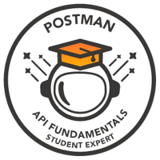
      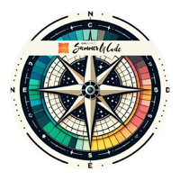
      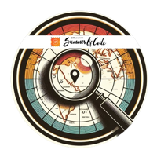
      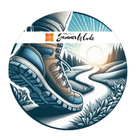
      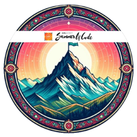
      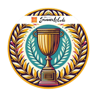
      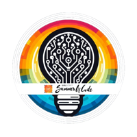
      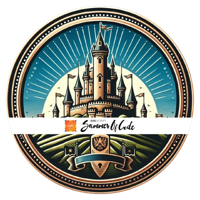
      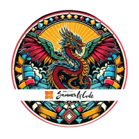
      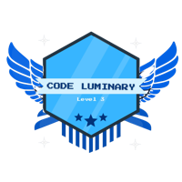
      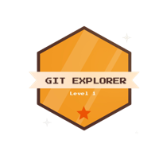
      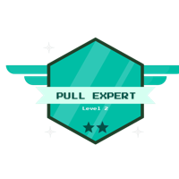
    </a>
  

  
<b>🎖️ Holopin badges</b>

   
  

 

<!-- ───────────────────────────── FOOTER ───────────────────────────── -->

  <b>Let's build something that ships.</b> Reach me at <a href="mailto:krishanmourya.sh@gmail.com">krishanmourya.sh@gmail.com</a> 
  <!-- LAST_UPDATED:START -->
Auto-updated on Oct 2026
<!-- LAST_UPDATED:END -->

