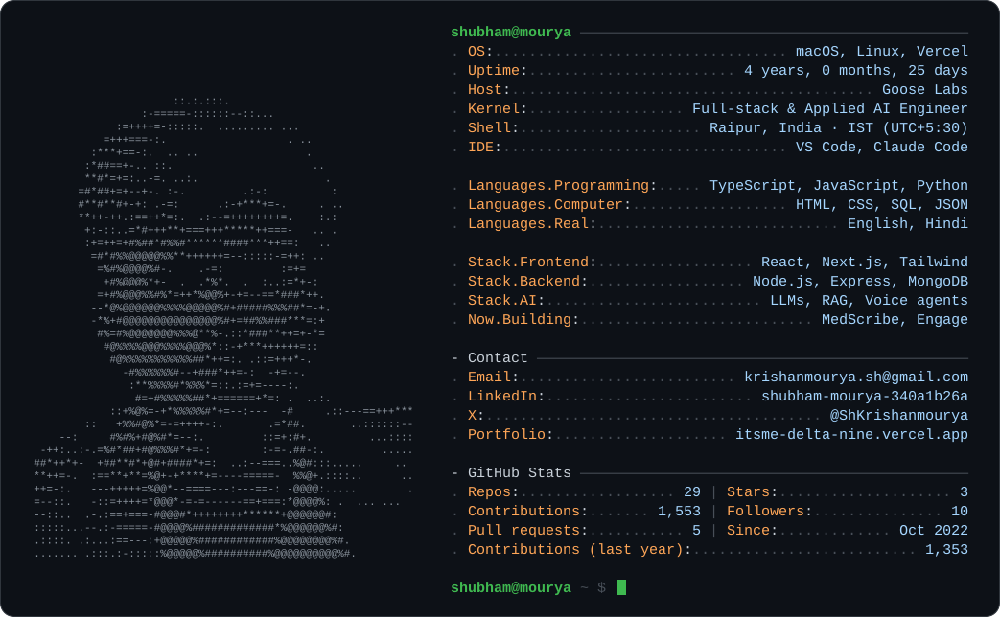

<a href="https://itsme-delta-nine.vercel.app">
  <picture>
    <source media="(prefers-color-scheme: dark)" srcset="assets/neofetch-dark.svg" />
    <source media="(prefers-color-scheme: light)" srcset="assets/neofetch-light.svg" />
    
  </picture>
</a>

### Hey, I'm Shubham. I build AI products that actually ship.

Full-stack & applied AI engineer at **[Goose Labs](https://gooselabs.in)**, building AI-first healthcare SaaS end to end, from product thinking and UI to architecture, testing and deployment. I started in the MERN stack and grew into generative AI: voice agents, RAG, embeddings, transcription and automation.

### Selected work

| | |
| :-- | :-- |
| **[MedScribe](https://mediscribe.gooselabs.in/)** | AI clinical documentation. Turns doctor–patient conversations into structured charts in seconds. |
| **[Engage](https://engage.gooselabs.in/)** | WhatsApp patient-engagement SaaS for reminders, no-show recovery and lapsed-patient follow-ups. |
| **[Hum Paanch](https://yi-hum-5-voice-agent.vercel.app/)** | Voice-first AI event guide built with Next.js and ElevenLabs Conversational AI. |
| **[Prānaa](https://pranaa.in/)** | Digital front door for a longevity clinic, covering patient journey, digital intake and diagnostics. |
| **[Datesite](https://datesite-sfbp.vercel.app/)** | Storytelling-led e-commerce with a gift-box builder, cart and checkout. |

Company work is private. Case studies are on my <a href="https://itsme-delta-nine.vercel.app">portfolio</a>.

### Latest open-source builds

<!-- LATEST_PROJECTS:START -->
- [**Therapy-rate-card**](https://github.com/shubham21881/Therapy-rate-card) — Print-ready A4 therapy rate card for Prānaa, built with Next.js and Tailwind CSS. `JavaScript` · [Live demo ↗](https://therapy-rate-card.vercel.app) · updated May 2026
- [**final-web**](https://github.com/shubham21881/final-web) — Marketing website for Savefuel Technology, an eco-friendly energy solutions company. HTML, CSS and JavaScript. `CSS` · [Live demo ↗](https://final-web-lemon.vercel.app) · updated May 2026
- [**handlebar**](https://github.com/shubham21881/handlebar) — Express + Handlebars server that renders patient summary reports: demographics, visits, questionnaires, prescriptions and diagnostics. `Handlebars` · updated Jan 2026
- [**meta-form**](https://github.com/shubham21881/meta-form) — Official patient form for Prānaa, built as a lightweight single-page HTML form. `HTML` · [Live demo ↗](https://meta-form-kohl.vercel.app) · updated Nov 2025
- [**plantshazaam**](https://github.com/shubham21881/plantshazaam) — Mobile-first app to catalog and care for plants, with AI-generated plant images and care suggestions (OpenAI). React, Express, MySQL, Docker. `JavaScript` · [Live demo ↗](https://plantshazaam.vercel.app) · updated Nov 2025
- [**Pranaa-page**](https://github.com/shubham21881/Pranaa-page) — Next.js landing page for Prānaa's diagnostic testing: vitamins, minerals, hormonal, immune and lifestyle health. `TypeScript` · [Live demo ↗](https://pranaa-page.vercel.app) · updated Oct 2025
<!-- LATEST_PROJECTS:END -->

  
<b>Open source & achievements</b>

   

GirlScript Summer of Code '24 · Hacktoberfest '24 · Social Winter of Code · Postman API Fundamentals Student Expert

  

    <a href="https://gssoc.girlscript.tech/leaderboard">
      
      
      
      
      
      
      
      
      
      
      
      
    </a>
  

  

---

Reach me at <a href="mailto:krishanmourya.sh@gmail.com">krishanmourya.sh@gmail.com</a> · <a href="https://www.linkedin.com/in/shubham-mourya-340a1b26a/">LinkedIn</a> · <a href="https://x.com/ShKrishanmourya">X</a> · <a href="https://hashnode.com/@Shubham21881">Hashnode</a>. The card above is regenerated daily by GitHub Actions.
<!-- LAST_UPDATED:START -->
Auto-updated on Oct 2026
<!-- LAST_UPDATED:END -->
